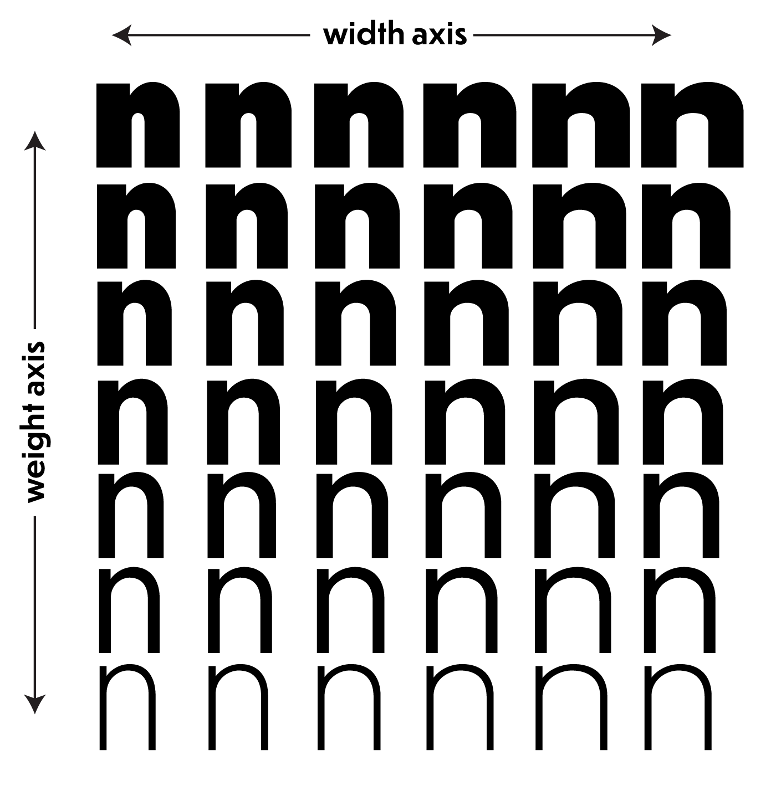

# WebRTC - Development Diary
## Variabel Font Controller

**Desktop:** een groot canvas met een  woord/zin (ingegeven door user).
Zwarte tekst op witte achtergrond met focus op typografische variaties.

**Smartphone:** 
User kan een woord/zin ingeven → komt op de desktop. 
Fonts worden dynamisch door font, font weight, font size, letterspacing ,etc aan te passen.

**Bewegingen:**
- x-position: font-weight 
- tilt: Normal font naar cursief
- schudden: font-size groter/ width axis breder

## Planning
**Week 1**:
- **GitHub repo** aangemaakt + ingediend
- initialized
- **concept** bedenken

**Week 2**:  
- **WebRTC datachannel**
 → 1-op-1 via QR-sessie + websockets?
- **Test tekst op scherm** → Ervoor zorgen dat de input op de desktop belandt. 

## AI Reflectie 
Nog geen AI gebruikt.

